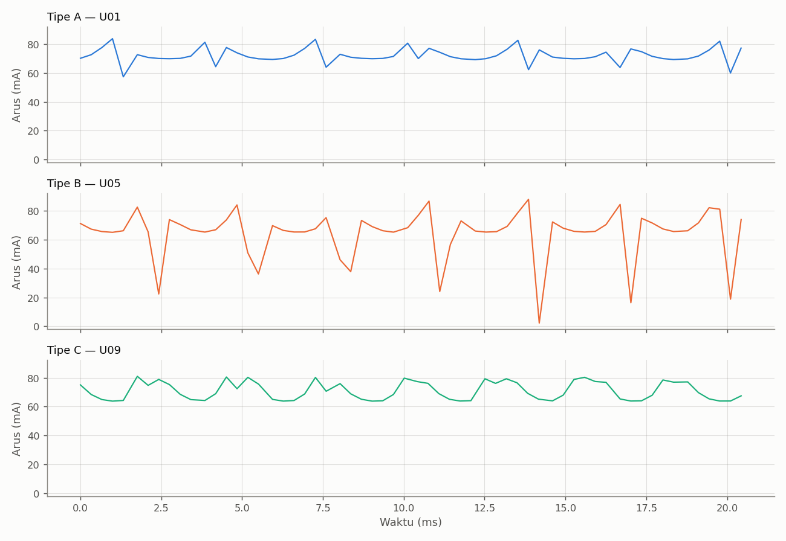
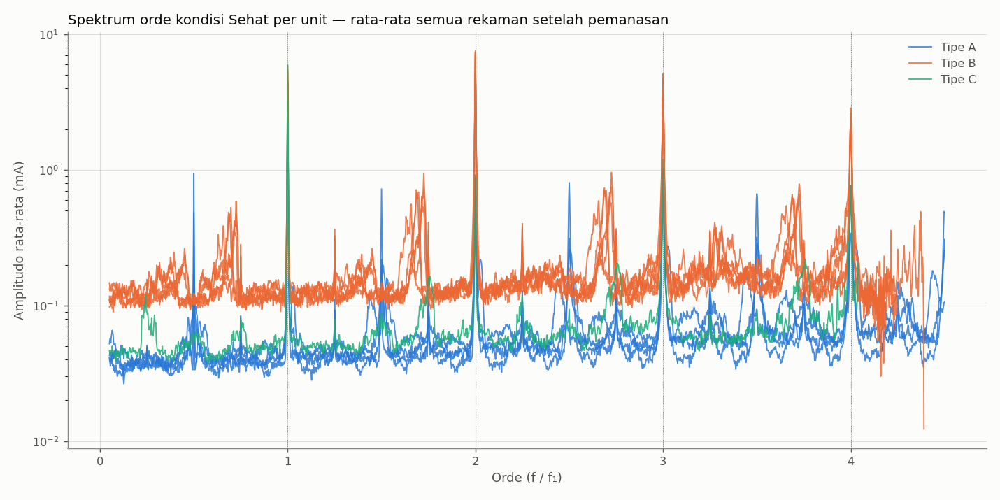
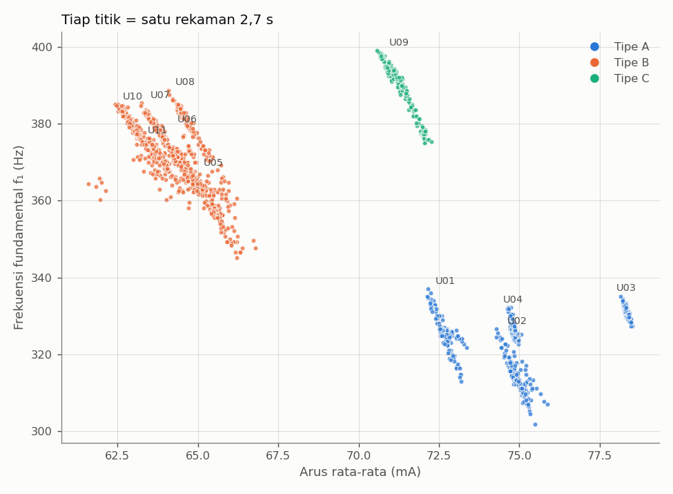

# Analisis Gerbang Kelayakan — Langkah 1 (Lengkap): 11 Unit Kondisi Sehat

*Tanggal: 16-10-2026 · Data: sesi s4, unit U01–U11 · Skrip: `tools/overlay_orde.py --tipe ...` · Lanjutan dari [analisis-gerbang-kelayakan-1.md](analisis-gerbang-kelayakan-1.md)*

## Ringkasan

1. Sebelas kipas berlabel sama (Hanaya FAN5010DC, 12 V / 0,09 A, toko yang sama) ternyata terbagi menjadi **tiga karakteristik arus** yang berbeda jelas. Perbedaan ini kemungkinan besar berasal dari rangkaian penggerak motor di dalam kipas, karena bentuk luar, stiker, dan bunyinya identik.
2. **Tipe A** (U01–U04) dan **tipe B** (U05–U08, U10, U11) dipakai sebagai unit utama. **U09** (tipe C, satu-satunya) dijadikan **unit cadangan**. Hasilnya sudah dikonfirmasi dengan rekaman ulang tanpa beban listrik besar lain di jaringan.
3. Di dalam satu tipe, unit-unit kipas cukup mirip. Antar tipe, perbedaannya sangat besar (riak/DC 6 % vs 25 %). Rancangan eksperimen perlu menyertakan **kedua tipe di setiap jalur perlakuan**, supaya model belajar mengenali kondisi, bukan tipe kipas.
4. Tipe B menghasilkan riak dengan perubahan sangat tajam, sehingga banyak harmonik tinggi **ter-*alias*** pada laju cuplik 3030 SPS. Hal ini perlu ditangani sebelum pengumpulan data sapuan PWM.

## 1. Data

| Tipe | Unit | Riwayat | Rekaman dianalisis |
|---|---|---|---|
| A | U01, U02 | sudah beberapa kali dioperasikan | 136 per unit |
| A | U03, U04 | inreyen 30 menit | 136–150 per unit |
| B | U05, U06, U07, U08, U10, U11 | inreyen 1 jam | 136–150 per unit |
| C | U09 | inreyen 1 jam | 150 (+ 30 rekaman ulang) |

Kondisi: 12,72 V tanpa PWM, dudukan terstandar, kipas angin ruangan mati, 0 konversi terlewat di semua rekaman. Rekaman 60 detik pertama tiap unit dibuang (pemanasan).

## 2. Bentuk gelombang arus

- **Tipe A:** riak halus di sekitar 70–75 mA dengan penurunan kecil setiap komutasi (p-p ±28 mA).
- **Tipe B:** arus **anjlok tajam hingga mendekati 0–40 mA** setiap komutasi (p-p ±86 mA). Pola ini khas penggerak yang memutus arus sepenuhnya saat pergantian fasa.
- **Tipe C (U09):** bentuk trapesium tanpa penurunan tajam (p-p ±27 mA), berbeda dari keduanya.

## 3. Ringkasan ciri per unit

| Unit | Tipe | f₁ (Hz) | I (mA) | Riak/DC (%) | Amplitudo orde 1 (mA) | Amplitudo orde 2 (mA) |
|---|---|---|---|---|---|---|
| U01 | A | 325,3 ± 4,6 | 72,70 | 6,02 | 1,85 | 1,07 |
| U02 | A | 313,9 ± 4,6 | 74,96 | 5,97 | 1,85 | 1,01 |
| U03 | A | 331,0 ± 1,6 | 78,34 | 5,88 | 2,05 | 0,65 |
| U04 | A | 326,9 ± 2,0 | 74,82 | 5,92 | 1,92 | 0,95 |
| U05 | B | 358,3 ± 5,5 | 65,48 | 24,98 | 5,26 | 8,42 |
| U06 | B | 368,9 ± 4,8 | 64,75 | 25,20 | 5,48 | 8,34 |
| U07 | B | 376,0 ± 5,8 | 63,93 | 24,09 | 4,50 | 7,89 |
| U08 | B | 379,8 ± 5,1 | 64,71 | 24,26 | 4,19 | 7,85 |
| U10 | B | 378,1 ± 5,2 | 63,06 | 25,30 | 4,46 | 7,46 |
| U11 | B | 370,5 ± 4,0 | 63,72 | 25,99 | 5,89 | 8,49 |
| U09 | C | 388,9 ± 6,8 | 71,33 | 9,92 | 5,96 | 0,99 |

Pengamatan:

- **Riak/DC adalah pembeda tipe yang sangat tegas:** 5,9–6,0 % (A), 24,1–26,0 % (B), 9,9 % (C). Variasi di dalam satu tipe kecil (±0,2–0,8 poin).
- **Di dalam tipe B, unit-unit saling tumpang tindih** pada bidang f₁–arus (lihat Gambar 4). Sebaliknya, keempat unit tipe A terpisah satu sama lain pada sumbu arus.
- Tipe B lebih cepat (f₁ 358–380 Hz) dan menarik arus lebih kecil (63–65,5 mA) dibanding tipe A (314–331 Hz, 72,7–78,3 mA).
- Pada **semua tipe**, kecepatan berfluktuasi ±1–2 % dan selalu berbanding terbalik dengan arus.

## 4. Spektrum orde dan sebaran f₁–arus

- Orde bulat (1–4 × f₁) muncul pada semua tipe, tetapi rasio amplitudonya berbeda: tipe B memiliki orde 2 yang paling kuat, sedangkan tipe A dan C didominasi orde 1.
- **Lantai derau tipe B ±0,11 mA, hampir 3× tipe A (±0,04 mA).** Ini konsisten dengan banyaknya harmonik tinggi yang ter-*alias* dan menyebar ke seluruh spektrum.
- Pada tipe B, puncak lebar di orde ≈ 0,7; 1,7; 2,7; 3,7 adalah ***alias*** harmonik ke-13 s.d. ke-16 (di sekitar 2 × laju cuplik). Komponen ini bergeser berlawanan arah dengan kecepatan, sehingga tidak boleh dipakai sebagai ciri.
- Amplitudo di orde ¼ f₁ (kandidat 1× putaran, tanda tangan Tidak Seimbang):

  | Tipe | Nilai per unit (mA) | σ antar-unit (mA) | Lantai derau (mA) |
  |---|---|---|---|
  | A | 0,075 · 0,070 · 0,092 · 0,084 | 0,010 | 0,04 |
  | B | 0,51 · 0,23 · 0,23 · 0,23 · 0,23 · 0,25 | 0,11 (0,012 tanpa U05) | 0,11 |
  | C | 0,33 | — | 0,05 |

  Pada tipe B, hubungan f₁ = 4 × putaran **belum terbukti**. Puncak orde ¼ yang jelas pada tipe A tidak tampak pada tipe B, dan U05 memiliki garis dasar 2× lebih tinggi dari unit B lainnya.

## 5. Implikasi dan usulan (perlu persetujuan dosen pembimbing)

**a. Pembagian unit ke jalur perlakuan, dengan kedua tipe di setiap jalur:**

| Jalur | Perlakuan | Usulan unit | Tipe A | Tipe B |
|---|---|---|---|---|
| A | Sehat → blokade → massa 33/67/100 mg | 2 tipe A + 2 tipe B | 2 | 2 |
| B | Sehat → blokade | 1 tipe A + 2 tipe B | 1 | 2 |
| C | Sehat → bilah dipatahkan | 1 tipe B | — | 1 |
| E | Tidak diberi perlakuan (kontrol) | 1 tipe A + 1 tipe B | 1 | 1 |
| Cadangan | — | U09 (tipe C) | — | — |

Cakupan: Aliran Terhambat 7 unit (3 A + 4 B), Tidak Seimbang 4 unit (2 A + 2 B). Penentuan unit mana masuk jalur mana dapat dilakukan secara acak di dalam tiap tipe.

**b. Pemilihan ciri:** gunakan ciri yang dinormalisasi (rasio terhadap DC atau terhadap amplitudo orde 1) dan berbasis orde. Arus absolut dan riak/DC sangat bergantung pada tipe, sehingga berisiko membuat model mengenali tipe kipas, bukan kondisinya.

**c. Validasi:** selain *leave-one-unit-out*, laporkan akurasi per tipe, dan bila memungkinkan uji **lintas tipe** (latih pada satu tipe, uji pada tipe lain) sebagai ukuran generalisasi.

**d. *Aliasing* pada tipe B (masalah teknis yang perlu diputuskan sebelum sapuan PWM).** Pilihan yang dapat diuji:
1. Menaikkan laju cuplik ke 4,9 kSPS (VSHCT 204 µs). Perlu uji apakah I²C sanggup tanpa konversi terlewat.
2. Menambahkan tapis RC diferensial di masukan INA226 (IN+/IN−). Perlu dipilih nilai R yang kecil agar arus bias masukan INA226 tidak menimbulkan galat.
3. Menerima *alias* dan hanya memakai ciri di orde rendah yang tidak tercemar.

## 6. Keterbatasan

- Hanya satu sesi (s4). Sesi kedua (s5) untuk validasi antar-sesi belum direkam.
- Semua pada tegangan penuh; belum ada data sapuan PWM.
- Penyebab perbedaan tipe (rangkaian penggerak internal) belum diverifikasi secara fisik, misalnya dengan membongkar satu unit.
